<p align="center">
  
</p>

<p align="center">
  <strong>La puerta de entrada web a una red de cuidado que transforma una caída en una alerta accionable.</strong>
</p>

<p align="center">
  
  
  
  
  
</p>

## Descripción general

**Equilibra Web** es el sitio de presentación y descarga del ecosistema Equilibra, un sistema de asistencia orientado a detectar caídas y acercar la alerta a familiares o cuidadores.

La web explica visualmente el flujo principal del producto:

1. Un sensor **ESP32 + MPU6050** detecta un impacto y emite una señal mediante Bluetooth clásico.
2. Un teléfono en modo **Estación Base** recibe la señal, obtiene la ubicación y sincroniza el evento.
3. Un teléfono en modo **Monitor Remoto** muestra la alerta, la ubicación y el historial a la red de cuidado.

Este repositorio contiene exclusivamente la **landing web**. Las referencias a ESP32, Flutter, Firebase y OpenStreetMap describen el ecosistema presentado por la interfaz; su firmware, aplicación móvil y servicios no están implementados en este código.

## Características principales

- Landing de una sola página con navegación por secciones y diseño adaptable a móvil y escritorio.
- Explicación ilustrada del recorrido sensor → estación → monitor remoto.
- Presentación de los modos **Estación Base** y **Monitor Remoto**.
- Simulación interactiva del estado de monitoreo y de una alerta de caída.
- Tarjetas de descarga para Android e iOS con compatibilidad, permisos e instrucciones.
- Enlaces y versión de las descargas centralizados en `src/config/downloads.ts`.
- Animaciones CSS, microinteracciones y soporte para `prefers-reduced-motion`.
- Elementos de accesibilidad como enlace para saltar al contenido, etiquetas ARIA y estados de foco visibles.
- Protección mediante `MutationObserver` frente a overlays externos de alta prioridad fuera de la aplicación.
- Build estático optimizado, listo para desplegar desde `dist/`.

## Arquitectura y stack tecnológico

### Aplicación web

| Tecnología | Uso en el proyecto |
| --- | --- |
| [React](https://react.dev/) | Componentes, estado del menú y simulación interactiva de alertas. |
| [TypeScript](https://www.typescriptlang.org/) | Tipado estricto de componentes y configuración de descargas. |
| [Vite](https://vite.dev/) | Servidor de desarrollo, compilación y previsualización del build. |
| CSS nativo | Sistema visual responsive, animaciones y variables de diseño. |
| [Lucide React](https://lucide.dev/) | Iconografía general de la interfaz. |
| [React Icons](https://react-icons.github.io/react-icons/) | Iconos de Android y Apple. |
| [ESLint](https://eslint.org/) | Análisis estático con reglas para TypeScript, Hooks y React Refresh. |
| Google Fonts | Familias tipográficas Manrope y Newsreader cargadas desde `index.html`. |

La aplicación es una SPA sin router y sin backend propio. `src/main.tsx` monta el componente raíz, `src/App.tsx` reúne las secciones y componentes visuales, y `src/styles.css` define la identidad visual y el comportamiento responsive.

### Flujo representado

```text
ESP32 + MPU6050
       │ Bluetooth clásico / SPP
       ▼
Teléfono Estación Base
       │ GPS + sincronización en tiempo real
       ▼
Monitor Remoto / red de cuidado
```

> Este diagrama documenta el producto que presenta la landing. No implica que esas integraciones formen parte del runtime de este repositorio web.

## Instalación y ejecución local

### Requisitos

- Node.js y npm.
- Git, si se parte del repositorio remoto.

El proyecto no fija una versión concreta de Node.js en `package.json`.

### 1. Clonar y entrar al proyecto

```bash
git clone <URL_DEL_REPOSITORIO>
cd Equilibra-web
```

La copia analizada no contiene metadatos de Git, por lo que la URL remota no se puede deducir sin inventarla. Sustituye `<URL_DEL_REPOSITORIO>` por la URL real del repositorio.

### 2. Instalar dependencias

El repositorio incluye `package-lock.json`; para una instalación reproducible:

```bash
npm ci
```

### 3. Configurar el entorno (opcional)

No se requiere un archivo `.env` para iniciar el sitio. Si necesitas reemplazar el enlace de descarga de iOS, crea `.env.local` en la raíz:

```dotenv
VITE_IOS_MEDIAFIRE_URL=https://dominio.example/ruta/equilibra.ipa
```

Solo `VITE_IOS_MEDIAFIRE_URL` es leída actualmente por el código. Los enlaces restantes y la versión se configuran directamente en `src/config/downloads.ts`.

### 4. Iniciar el servidor de desarrollo

```bash
npm run dev
```

Vite mostrará en la terminal la URL local disponible, habitualmente `http://localhost:5173`.

### 5. Validar y compilar

```bash
npm run lint
npm run build
```

La compilación optimizada se genera en `dist/`. Para revisarla localmente:

```bash
npm run preview
```

## Scripts disponibles

| Comando | Descripción |
| --- | --- |
| `npm run dev` | Inicia Vite en modo desarrollo. |
| `npm run build` | Comprueba TypeScript y genera el build de producción. |
| `npm run lint` | Ejecuta ESLint sobre el proyecto. |
| `npm run preview` | Sirve localmente el contenido compilado de `dist/`. |

## Configuración de descargas

Los canales disponibles se definen en `src/config/downloads.ts`:

- `downloads.android.apk`: enlace externo del APK.
- `downloads.android.googlePlay`: ficha de Google Play; un valor `null` se muestra como **Próximamente**.
- `downloads.ios.ipa`: enlace de descarga iOS, reemplazable con `VITE_IOS_MEDIAFIRE_URL`.
- `downloads.ios.appStore` y `downloads.ios.testFlight`: canales alternativos actualmente configurados como no disponibles.
- `downloads.version` y `downloads.build`: versión mostrada por la interfaz.

Revisa los enlaces de ejemplo incluidos en esa configuración antes de publicar el sitio.

## Estructura del proyecto

```text
Equilibra-web/
├── assets/
│   └── banner.svg              # Banner animado del README
├── public/
│   ├── logo.png                # Identidad visual usada por la web
│   └── robots.txt
├── src/
│   ├── config/
│   │   └── downloads.ts        # URLs y metadatos de descarga
│   ├── App.tsx                 # Landing, secciones y componentes
│   ├── main.tsx                # Punto de entrada de React
│   ├── overlayProtection.ts    # Cuarentena de overlays externos
│   └── styles.css              # Estilos, responsive y animaciones
├── eslint.config.js
├── index.html
├── package.json
├── package-lock.json
├── tsconfig.app.json
├── tsconfig.json
├── tsconfig.node.json
└── vite.config.ts
```

## Despliegue

El resultado de `npm run build` es un sitio estático dentro de `dist/`. Puede publicarse en cualquier servicio capaz de servir archivos estáticos. Como la navegación interna utiliza anclas y no rutas del lado del cliente, no necesita reglas especiales de reescritura.

---

<p align="center">Tecnología que acompaña, incluso a la distancia.</p>
